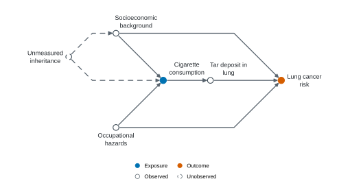
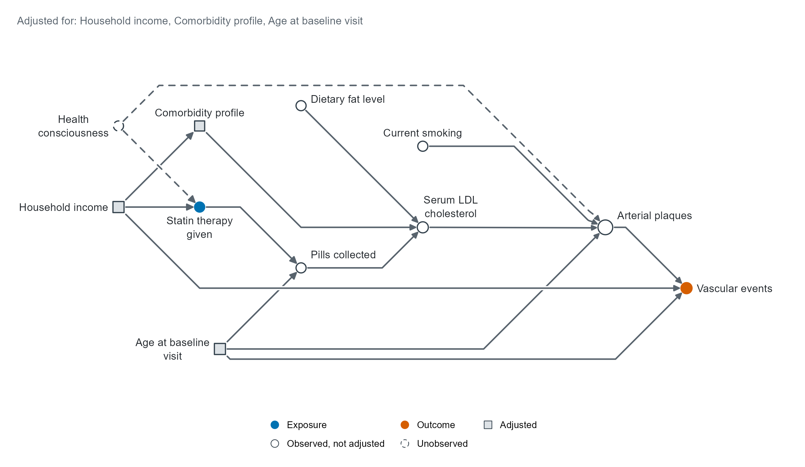

# metrodag

<!-- badges: start -->
[](https://github.com/hdbt/metrodag/actions/workflows/R-CMD-check.yaml)
[](https://lifecycle.r-lib.org/articles/stages.html#experimental)
[](LICENSE.md)
<!-- badges: end -->

**Publication-oriented causal DAGs, without hand-placing every node.**

`metrodag` combines a deterministic layered layout with the regular lines of a
metro map. Long arrows route around intermediate variables, arrowheads stop at
station rims, and labels adapt to the size of the exported figure. The default
is a clean, white, restrained publication style.

```r
# install.packages("remotes")
remotes::install_github("hdbt/metrodag")
```

```r
library(metrodag)

edges <- data.frame(
  from = c("C", "C", "X", "M", "U", "U", "S", "S"),
  to   = c("X", "Y", "M", "Y", "C", "X", "Y", "X")
)
p <- metro_dag(
  edges,
  exposure = "X", outcome = "Y", unobserved = "U",
  labels = c(
    C = "Socioeconomic background", X = "Cigarette consumption",
    M = "Tar deposit in lung", Y = "Lung cancer risk",
    U = "Unmeasured inheritance", S = "Occupational hazards"
  )
)
p
save_metro_dag("dag.pdf", p, width = "double")   # 180 mm, automatic height
save_metro_dag("dag.svg", p, width = 120)        # 120 mm vector artwork
```



The roles `exposure`, `outcome`, `adjusted`, `unobserved` and `selected` are
explicit annotations supplied by the analyst; nothing is inferred from the
graph. Exposure and outcome use filled markers, adjusted variables are squares,
selected variables are double-outlined squares, and unobserved variables and
their outgoing arrows are dashed.

## Learn metrodag

| Guide | What you will learn |
|:--|:--|
| [Getting started](vignettes/metrodag.Rmd) | Build a DAG from an edge table, add labels, inspect it, and export it |
| [Variables and analysis views](vignettes/analysis-views.Rmd) | Observability, adjustment, custom groups and research targets; compare analyses and run DAGitty checks |
| [Publication figures](vignettes/publication.Rmd) | Styles, fonts, labels, temporal ranks, alignment, and output dimensions |
| [Algorithm and constraints](vignettes/algorithm.Rmd) | How the layout heuristic works and where it stops |

The rendered guides and function reference are on the
[documentation site](https://hdbt.github.io/metrodag/). Locally, install with
`build_vignettes = TRUE` and run `browseVignettes("metrodag")`.

## Inputs

`metro_dag()` accepts an `igraph` (including `tidygraph`), a `dagitty` DAG, a
ggdag `tidy_dagitty`, a two-column edge matrix, or a data frame with `from` and
`to` columns. `metro_graph()` builds a graph from node and edge tables, keeping
isolated variables and `label`/`role` columns; `metro_graph_from_adjacency()`
reads a named binary adjacency matrix. Vertex names identify variables; display
labels can be longer and are wrapped on the output device.

## One graph, several analyses

Compute the layout once and reuse it, so node positions and routes stay fixed
while the exposure, outcome and adjustment set change:

```r
fixed <- attr(p, "metrodag_layout")
crude <- metro_dag(fixed, exposure = "X", outcome = "Y", unadjusted = TRUE,
  estimand = "Unadjusted X-Y association")
total <- metro_dag(fixed, exposure = "X", outcome = "Y", adjusted = "C",
  estimand = "Total effect of X on Y")

comparison <- compare_metro_dags(fixed, list(
  Unadjusted = list(exposure = "X", outcome = "Y", unadjusted = TRUE),
  Adjusted = list(exposure = "X", outcome = "Y", adjusted = "C")
))
save_metro_dag("analyses.pdf", comparison, width = 190)
```

The views keep the display labels of `p`. With these labels, two panels side
by side need 190 mm; `ncol = 1` stacks them within 180 mm.


`estimand` is a descriptive label, not an identification check. With the
optional `dagitty` package, `check_metro_adjustment(p)` tests whether the
selected set meets the adjustment criterion for a total effect under the
assumed graph.

## Usually, these are the only adjustments you need

| Need | Argument / function |
|:---|:---|
| Different orientation | `direction = "down"`, `"up"`, or `"left"` |
| Shorter display names | `labels = c(node_name = "Display name")` |
| Preserve manual line breaks | `label_wrap = NULL` |
| Black and white | `style = "monochrome"` |
| Colourful metro lines | `style = "metro"` |
| Your own colours, arrowheads or legend text | `style = metro_style(exposure_fill = "#1B9E77", legend_labels = c(exposure = "Treatment"))` |
| Dashed or emphasised arrows | `edge_style = list("U->X" = list(linetype = "dotted"), "X->M" = list(width = 0.8))` |
| Explain an arrow convention in the legend | `edge_legend = c(dotted = "Assumed, uncertain")` |
| Mark selection (e.g. hospital admission) | `selected = "P"` |
| Draw DAGitty `A <-> B` arcs | `metro_dag(dag, bidirected = "latent")` |
| Emphasise paths left open by the adjustment set | `highlight_paths(p, paths = "biasing")` |
| Outcome distinct from exposure without colour | `metro_style(outcome_marker = "ring")` (default in monochrome) |
| Match the manuscript font | `family = "serif"` or an installed font family |
| Nudge one label by 2 mm upwards | `label_nudge = list(C = c(0, 2))` |
| Specify temporal ranks | `rank = c(A = 0, B = 1, C = 2)` |
| Keep repeated measures on one row | `align = list(c("X1", "X2", "X3"))` |
| Name the ranks, such as survey waves | `rank_labels = c("Baseline", "Wave 1", "Wave 2")` |
| Distinguish display categories | `node_groups = list("Selection factors" = "S")` |
| Single- or double-column figure | `save_metro_dag("dag.pdf", p, width = "single")` or `"double"` |
| Vector output for a journal | `.pdf`, `.svg`, or `.eps` filename |
| Add a title or caption | `p + ggplot2::labs(title = "...", caption = "...")` |
| Combine with other plots | `patchwork::wrap_elements(full = as_metro_grob(p))` |
| Draft in a small preview without errors | `on_error = "warn"` |
| Check the figure at its printed size and format | `diagnose_metro_dag(p, width = 85, device = "svg")` |

Fonts, markers and line widths are specified in physical units. Labels are
placed when the plot is drawn, so always inspect the exported file at its final
size. If the requested dimensions cannot fit every arrow and station, export
stops with an informative error rather than silently omitting edges;
`diagnose_metro_dag()` lists the affected nodes, edges and labels. Diagnose on
the device you export to: text is measured on that device, so a PDF check can
pass where an SVG or PNG export of the same size warns.

## Gallery

Six annotated DAGs provide a stable evaluation set for the layout algorithm;
their edges, labels and roles stay fixed across releases. Browse the images,
metrics and diagnostics in [the benchmark report](inst/benchmarks/REPORT.md),
or regenerate them with `Rscript data-raw/annotated_gallery.R`.

[](inst/benchmarks/figures/annotated_04_statin_events.svg)

## Cite metrodag

Run `citation("metrodag")` in R, or use [CITATION.cff](CITATION.cff).

## Contributing

Bug reports and pull requests are welcome; see [CONTRIBUTING.md](CONTRIBUTING.md).
Development notes live in [DEVELOPMENT.md](DEVELOPMENT.md) and open work in
[ROADMAP.md](ROADMAP.md).
