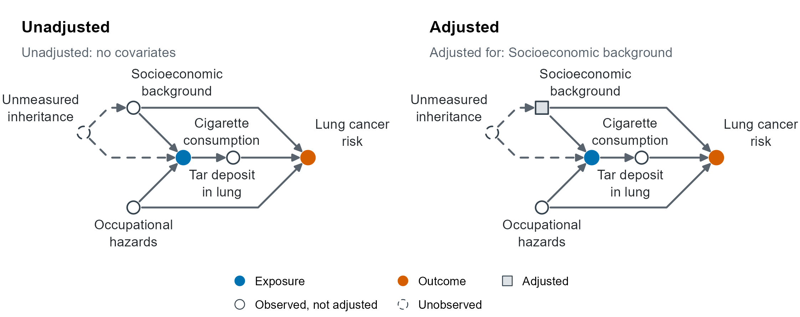

# metrodag: Monotone Schematic Layouts for Directed Acyclic Graphs 

<!-- badges: start -->
[](https://CRAN.R-project.org/package=metrodag)
[](https://github.com/hdbt/metrodag/actions/workflows/R-CMD-check.yaml)
[](https://www.r-project.org/)
[](https://opensource.org/licenses/MIT)
[](https://lifecycle.r-lib.org/articles/stages.html#experimental)
<!-- badges: end -->

## Overview

The metrodag package draws causal directed acyclic graphs (DAGs) for
epidemiology and causal inference as publication-ready figures, without
hand-placing every node. A deterministic layered layout, in the tradition of
Sugiyama, Tagawa and Toda (1981), is combined with the regular lines of a metro
map: long arrows route around intermediate variables along vertical and
diagonal tracks, arrowheads stop at station rims, and labels are measured on
the output device so exported figures stay legible at manuscript sizes.

Analysis roles (exposure, outcome, adjusted, unobserved, selected) are explicit
annotations supplied by the analyst; nothing is inferred from the graph. They
annotate one fixed geometry, so several analyses of the same causal model can
be shown side by side.



## Key Features

- **One-call Workflow**: `metro_dag()` lays out, annotates and draws a DAG from
  an igraph, tidygraph, dagitty or ggdag object, an edge matrix or a
  `from`/`to` data frame
- **Deterministic Layout**: `layout_metro_dag()` gives the same drawing for the
  same graph on every platform, with octilinear routes, bounded refinement
  passes and optional `rank` and `align` constraints for temporal order and
  repeated measures
- **Publication Export**: `save_metro_dag()` writes PDF, SVG, EPS, PNG and TIFF
  at journal column widths (`"single"`, `"1.5"`, `"double"`), with automatic
  height and text measured on the export device
- **Fixed Geometry, Several Analyses**: reuse one layout across exposures,
  outcomes and adjustment sets; `compare_metro_dags()` aligns the views in
  panels of equal physical size with a single legend
- **Readability Diagnostics**: `diagnose_metro_dag()` reports station, arrow
  and label conflicts at the printed size and format; `layout_metrics()` and
  `count_crossings()` quantify the drawing
- **Causal Checks**: with the optional dagitty package,
  `check_metro_adjustment()` tests a total-effect adjustment set and
  `highlight_paths()` emphasises the paths it leaves open
- **Styles**: restrained publication, monochrome and colourful metro presets,
  customised with `metro_style()` and per-arrow `edge_style`
- **Composition**: `as_metro_grob()` combines figures with other plots, for
  example in patchwork layouts

## Installation

You can install the development version from GitHub:

```r
# install.packages("remotes")
remotes::install_github("hdbt/metrodag")
```

or, once it is released, the stable version from CRAN:

```r
install.packages("metrodag")
```

## Quick Start

```r
library(metrodag)

edges <- data.frame(
  from = c("C", "C", "X", "M", "U", "U", "S", "S"),
  to   = c("X", "Y", "M", "Y", "C", "X", "Y", "X")
)
p <- metro_dag(
  edges,
  exposure = "X", outcome = "Y", unobserved = "U",
  labels = c(
    C = "Socioeconomic background", X = "Cigarette consumption",
    M = "Tar deposit in lung", Y = "Lung cancer risk",
    U = "Unmeasured inheritance", S = "Occupational hazards"
  )
)
p
save_metro_dag("dag.pdf", p, width = "double")   # 180 mm, automatic height
save_metro_dag("dag.svg", p, width = 120)        # 120 mm vector artwork
```

Exposure and outcome use filled markers, adjusted variables are squares,
selected variables are double-outlined squares, and unobserved variables and
their outgoing arrows are dashed.

## How metrodag differs from other DAG tools

- **Layout and drawing are separate.** `layout_metro_dag()` computes the
  geometry; `metro_dag()` and `plot_metro_dag()` draw it. To show several
  analyses of one graph, reuse `attr(p, "metrodag_layout")` instead of
  recomputing the layout.
- **Roles are annotations you supply.** `exposure`, `outcome`, `adjusted`,
  `unobserved` and `selected` are never inferred from the graph, and they never
  move nodes or arrows.
- **`estimand` is a label, not a check.** Call `check_metro_adjustment()`
  (requires dagitty) to test an adjustment set; plotting never runs it.
- **metrodag is not built on ggdag.** dagitty and ggdag objects are accepted as
  input, but metrodag draws its own layers: restyle with `metro_style()` and
  `edge_style` rather than ggdag geoms. Ordinary ggplot2 additions such as
  `ggplot2::labs()` still work.
- **Text is measured on the output device.** `ggplot2::ggsave()` works, but
  `save_metro_dag()` adds journal column widths and automatic height, and
  refuses to write a figure that cannot fit every arrow. Check the figure with
  `diagnose_metro_dag()` at its final width and format.

## Main Functions

### `metro_dag()`
Draws a DAG with publication defaults in one call. It accepts an igraph
(including tidygraph), a dagitty or ggdag DAG, a two-column edge matrix, a data
frame with `from` and `to` columns, or a previously computed layout. Roles,
display labels, estimand titles, node groups and arrow styles are annotations
on top of the layout; the graph and its geometry are never modified by them.

### `metro_graph()` and `metro_graph_from_adjacency()`
Build a graph from explicit node and edge tables (keeping isolated variables
and `label`/`role` columns) or from a named binary adjacency matrix.

### `metrodag_examples()`
Returns small teaching graphs (`"chain"`, `"fork"`, `"collider"`, `"diamond"`,
`"long_edge"`, `"causal"`, `"dense"`) and seeded random DAGs as igraph objects,
for trying the package and writing reproducible examples.

### `layout_metro_dag()` and `plot_metro_dag()`
Compute the layout and draw it as separate steps. Long edges are expanded into
private waypoints before crossing reduction, routes use vertical and 45-degree
segments that avoid unrelated nodes, and a final pass removes unnecessary
bends without adding crossings or shared track. `rank` fixes temporal order,
`align` keeps repeated measures on one row, and `direction` rotates the
drawing.

### `compare_metro_dags()`
Computes one layout and shows several analysis views of the same causal graph
in aligned panels with equal physical sizes and a single role legend.

### `save_metro_dag()`
Exports a figure at publication dimensions. PDF, SVG and EPS are vector
formats; PNG and TIFF default to 600 dpi. If the requested size cannot fit
every arrow and station, export stops with an informative error rather than
silently dropping edges.

### `diagnose_metro_dag()`
Renders privately on the export device and lists station, edge and label
conflicts, including geometry outside the visible figure. Diagnose on the
device you export to: text is measured on that device.

### `check_metro_adjustment()` and `highlight_paths()`
With the optional dagitty package, check whether the chosen set meets the
adjustment criterion for a total effect under the assumed graph, and emphasise
the paths between exposure and outcome that remain open. Plotting never runs
these checks implicitly.

### `metro_style()`
Defines colours, arrowheads, station sizing and legend text. Start from the
`"publication"`, `"monochrome"` or `"metro"` preset and override only what the
figure needs.

### `as_metro_grob()`
Converts a figure to a grid grob that places its labels at the size it is
given, for composition with other plots.

### `layout_metrics()` and `count_crossings()`
Quantify a drawing: crossings, bends, shared track, area and node-edge
collisions.

## One graph, several analyses

Compute the layout once and reuse it, so node positions and routes stay fixed
while the exposure, outcome and adjustment set change:

```r
fixed <- attr(p, "metrodag_layout")
crude <- metro_dag(fixed, exposure = "X", outcome = "Y", unadjusted = TRUE,
  estimand = "Unadjusted X-Y association")
total <- metro_dag(fixed, exposure = "X", outcome = "Y", adjusted = "C",
  estimand = "Total effect of X on Y")

comparison <- compare_metro_dags(fixed, list(
  Unadjusted = list(exposure = "X", outcome = "Y", unadjusted = TRUE),
  Adjusted = list(exposure = "X", outcome = "Y", adjusted = "C")
))
save_metro_dag("analyses.pdf", comparison, width = 190)
```

The views keep the display labels of `p`. With these labels, two panels side
by side need 190 mm; `ncol = 1` stacks them within 180 mm.



`estimand` is a descriptive label, not an identification check. With the
optional dagitty package, `check_metro_adjustment(p)` tests whether the
selected set meets the adjustment criterion for a total effect under the
assumed graph.

## Common Adjustments

| Need | Argument / function |
|:---|:---|
| Different orientation | `direction = "down"`, `"up"`, or `"left"` |
| Shorter display names | `labels = c(node_name = "Display name")` |
| Preserve manual line breaks | `label_wrap = NULL` |
| Black and white | `style = "monochrome"` |
| Colourful metro lines | `style = "metro"` |
| Your own colours, arrowheads or legend text | `style = metro_style(exposure_fill = "#1B9E77", legend_labels = c(exposure = "Treatment"))` |
| Dashed or emphasised arrows | `edge_style = list("U->X" = list(linetype = "dotted"), "X->M" = list(width = 0.8))` |
| Explain an arrow convention in the legend | `edge_legend = c(dotted = "Assumed, uncertain")` |
| Mark selection (e.g. hospital admission) | `selected = "P"` |
| Draw DAGitty `A <-> B` arcs | `metro_dag(dag, bidirected = "latent")` |
| Emphasise paths left open by the adjustment set | `highlight_paths(p, paths = "biasing")` |
| Outcome distinct from exposure without colour | `metro_style(outcome_marker = "ring")` (default in monochrome) |
| Match the manuscript font | `family = "serif"` or an installed font family |
| Nudge one label by 2 mm upwards | `label_nudge = list(C = c(0, 2))` |
| Specify temporal ranks | `rank = c(A = 0, B = 1, C = 2)` |
| Keep repeated measures on one row | `align = list(c("X1", "X2", "X3"))` |
| Name the ranks, such as survey waves | `rank_labels = c("Baseline", "Wave 1", "Wave 2")` |
| Distinguish display categories | `node_groups = list("Selection factors" = "S")` |
| Single- or double-column figure | `save_metro_dag("dag.pdf", p, width = "single")` or `"double"` |
| Vector output for a journal | `.pdf`, `.svg`, or `.eps` filename |
| Add a title or caption | `p + ggplot2::labs(title = "...", caption = "...")` |
| Combine with other plots | `patchwork::wrap_elements(full = as_metro_grob(p))` |
| Draft in a small preview without errors | `on_error = "warn"` |
| Check the figure at its printed size and format | `diagnose_metro_dag(p, width = 85, device = "svg")` |

Fonts, markers and line widths are specified in physical units, and labels are
placed when the plot is drawn, so always inspect the exported file at its final
size.

## Gallery

Six annotated DAGs provide a stable evaluation set for the layout algorithm;
their edges, labels and roles stay fixed across releases. Browse the images,
metrics and diagnostics in [the visual review](https://github.com/hdbt/metrodag/blob/main/inst/benchmarks/VISUAL_REFINEMENT.md),
or regenerate them with `Rscript data-raw/annotated_gallery.R`.

[](https://github.com/hdbt/metrodag/blob/main/inst/benchmarks/figures/annotated_04_statin_events.svg)

The gallery shows layouts, not recommended analyses. In DAG 4, unmeasured
health consciousness (dashed) affects both statin therapy and arterial plaques,
so no set of measured variables meets the adjustment criterion for the total
effect under this graph; `check_metro_adjustment()` reports this for the set
drawn.

## Documentation

The rendered guides and function reference are on the
[documentation site](https://hdbt.github.io/metrodag/).

| Guide | What you will learn |
|:--|:--|
| [Getting started](https://hdbt.github.io/metrodag/articles/metrodag.html) | Build a DAG from an edge table, add labels, inspect it, and export it |
| [Variables and analysis views](https://hdbt.github.io/metrodag/articles/analysis-views.html) | Observability, adjustment, custom groups and research targets; compare analyses and run DAGitty checks |
| [Publication figures](https://hdbt.github.io/metrodag/articles/publication.html) | Styles, fonts, labels, temporal ranks, alignment, and output dimensions |
| [Recipes for common causal structures](https://hdbt.github.io/metrodag/articles/recipes.html) | Confounding and mediation, M-bias, instruments, selection bias, measurement error and treatment-confounder feedback, each with explicit roles |
| [Coming from ggdag or dagitty](https://hdbt.github.io/metrodag/articles/coming-from-ggdag.html) | Familiar ggdag and dagitty calls in metrodag, drawing each adjustment set you choose, and reporting a DAG |
| [Algorithm and constraints](https://hdbt.github.io/metrodag/articles/algorithm.html) | How the layout heuristic works and where it stops |

Locally, install with `build_vignettes = TRUE` and run:

```r
browseVignettes("metrodag")
```

## Dependencies

**Required:**

- R (>= 4.1.0)
- igraph
- ggplot2 (>= 3.4.0)
- gtable, grid, grDevices, stats, tools, utils

**Optional:**

- dagitty - for DAGitty input, adjustment checks and path highlighting
- ggdag (>= 0.2.13) - for ggdag `tidy_dagitty` input
- tidygraph - for tidygraph input
- svglite - for SVG export
- patchwork - for composing figures with other plots
- knitr, rmarkdown - for building vignettes
- testthat (>= 3.1.7) - for the test suite

## References

- Sugiyama, K., Tagawa, S., & Toda, M. (1981). Methods for visual understanding
  of hierarchical system structures. *IEEE Transactions on Systems, Man, and
  Cybernetics*, 11(2), 109-125. doi:10.1109/TSMC.1981.4308636

- Textor, J., van der Zander, B., Gilthorpe, M. S., Liśkiewicz, M., & Ellison,
  G. T. H. (2016). Robust causal inference using directed acyclic graphs: the R
  package 'dagitty'. *International Journal of Epidemiology*, 45(6),
  1887-1894. doi:10.1093/ije/dyw341

- Greenland, S., Pearl, J., & Robins, J. M. (1999). Causal diagrams for
  epidemiologic research. *Epidemiology*, 10(1), 37-48.
  doi:10.1097/00001648-199901000-00008

## Contributing

Contributions are welcome! Please feel free to open an issue or submit a pull
request; see [CONTRIBUTING.md](https://github.com/hdbt/metrodag/blob/main/CONTRIBUTING.md). Development notes live in
[DEVELOPMENT.md](https://github.com/hdbt/metrodag/blob/main/DEVELOPMENT.md) and open work in [ROADMAP.md](https://github.com/hdbt/metrodag/blob/main/ROADMAP.md).

## License

This project is licensed under the MIT License - see the [LICENSE.md](https://github.com/hdbt/metrodag/blob/main/LICENSE.md)
file for details.

## Citation

If you use this package in your research, please cite:

```text
Bulut H (2026). metrodag: Monotone Schematic Layouts for Directed Acyclic Graphs. R package version 0.3.0, https://github.com/hdbt/metrodag.
```

A BibTeX entry for LaTeX users is:

```bibtex
@Manual{Bulut2026metrodag,
  title  = {metrodag: Monotone Schematic Layouts for Directed Acyclic Graphs},
  author = {Hamid Bulut},
  year   = {2026},
  note   = {R package version 0.3.0},
  url    = {https://github.com/hdbt/metrodag}
}
```

You can also run `citation("metrodag")` in R, or use [CITATION.cff](https://github.com/hdbt/metrodag/blob/main/CITATION.cff).
