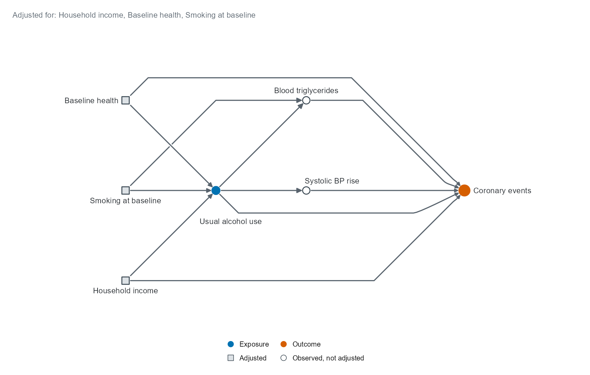
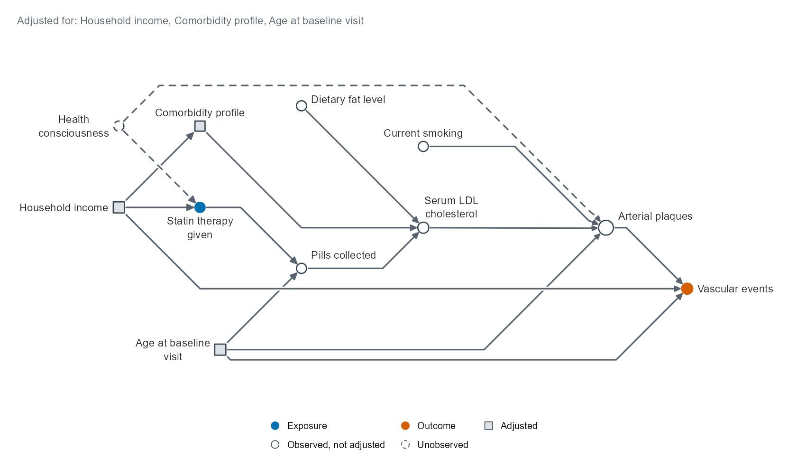

# Tighter layouts and cleaner final approaches

These comparisons address excess space in DAG 1 and the short middle approach
into DAG 4's outcome. The baseline is merged PR #31, commit
`70fb028a21b0cc29feb366efaacdbd6987125af6`. Both versions use automatic placement,
the same causal edges, annotations and labels, and 240 mm export width.
There are no manual node, route or label adjustments.

| Measure | DAG 1 before | DAG 1 after | DAG 4 before | DAG 4 after |
|:--|--:|--:|--:|--:|
| Span along the causal direction, grid units | 25 | 19 | 39 | 36 |
| Total line length, grid units | 156.57 | 123.57 | 327.18 | 301.18 |
| Bends | 15 | 15 | 18 | 18 |
| Crossings | 4 | 4 | 5 | 5 |
| Unrelated station collisions | 0 | 0 | 0 | 0 |

DAG 1 is 24% shorter along its causal direction in layout coordinates. At a
fixed export width, physical distances also depend on the automatic plot scale.
Less padding beside the causal direction removes surplus whitespace above and
below a horizontal drawing. Equal coordinate scaling retains 45-degree routes.
Thin chains and singleton drawings retain their previous padding and aspect.

DAG 4's Household income → Vascular events arrow now has a three-unit final
straight approach instead of one unit. The last diagonal finishes farther from
the outcome, leaving a clear horizontal arrival between the two diagonal arrows.
Its bend count and line length do not increase.

## DAG 1 — alcohol and heart disease

| Before | After |
|:--|:--|
| _DAG 1 before: figure not retained_ |  |

## DAG 4 — statin events

| Before | After |
|:--|:--|
| _DAG 4 before: figure not retained_ |  |

Editable SVG counterparts are in the same directory. Both current examples
pass PDF, SVG and PNG diagnostics at 180 and 240 mm with default wrapping;
PNG checks use the exported 180 dpi. Label placement includes a farther ring
and slightly off-centre positions above/below a station, which allow full
labels to fit between diagonal routes without manual nudges.

## Algorithm and limits

After section cleanup, the compactor shortens complete rank gaps. Each route
spanning a gap loses the same number of vertical steps inside it, while its
diagonal steps remain intact. Nodes retain their transverse coordinates and
rank membership. Supplied rank order and ties are preserved; their numeric
values still do not specify physical spacing. Route rows are reindexed after
steps are removed, retaining edge and path identities.

An approach refinement then moves steps from an earlier run into a final run
shorter than three units. Stations stay fixed during this refinement. Each
stage checks at most 24 candidates per component; compaction makes at most
two passes. Accept a candidate only when crossings, pairwise shared-track
length, bends and line length do not increase. Compaction retains at least
four-unit station spacing. Both stages retain existing route-to-station
clearance up to four units, with a floor of 0.8.

These are bounded preferences, not a global compactness optimum. Some gaps and
short approaches remain because changing them would compromise neighbouring
routes. The three-unit preference is measured in layout coordinates; physical
arrow clearance still depends on device size. Labels are placed at draw time,
and arbitrary dense graphs or long labels can still need a larger export.

All 22 benchmark fixtures preserve or improve crossings, shared-track length,
bends, line length and station collisions. Eleven have a smaller span along
the causal direction, and three have fewer bends. The causal README example
keeps its four bends, zero crossings, and straight C-to-X and S-to-X arrows.
See [compact_layout_metrics.csv](compact_layout_metrics.csv) and the
[reproduction commands](README.md). Timings are single-run smoke measurements
on a shared machine; they do not establish a speed improvement. The additional
candidate searches add work even when they find no acceptable change.
