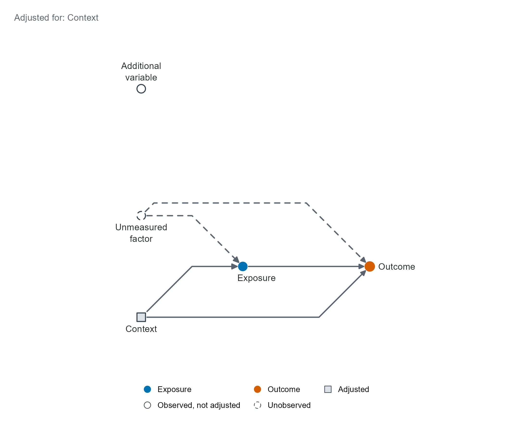

# Graph input compatibility

Baseline: main at `29a8063f3e9c266922c5709a60e8c1b11f17a570`, including merged PR #45 (input compatibility) and #46 (documentation). This follow-up normalizes table subclasses and accepts missing role placeholders. Layout and routing algorithms, the six annotated gallery models and their layout constraints are unchanged.

## Supported workflows

| Input | Behavior |
| --- | --- |
| `igraph`, including `tidygraph::tbl_graph` | Existing validation retains directed topology, identities, labels and role attributes; active tidygraph context does not redefine endpoints |
| DAGitty, including `ggdag::dagify()` output | Imports the directed DAG, isolates, explicit roles and named display labels |
| `ggdag::tidy_dagitty` | Uses public accessors; embedded DAG defines structure/roles and matching tidy-table labels take precedence |
| `metro_graph(nodes, edges)` | Explicit node table preserves isolates and metadata; endpoints must name declared nodes; extra edge attributes are retained |
| `metro_graph_from_adjacency(adjacency)` | Dense named binary matrices; row A, column B specifies A -> B; row and column permutations are matched by identity |
| Existing edge tables and two-column matrices | Existing interpretation is retained, including 2 by 2 edge matrices |

ggdag and tidygraph remain optional Suggested packages. Plain constructors return validated igraph objects without requiring those integrations. Table subclasses are normalized before named column selection; all-missing role columns remain unspecified, including logical or numeric NA placeholders. Constructors reject incomplete identities, unknown endpoints, duplicate edges and cycles. Nonbinary adjacency values are rejected; edge tables retain weights without treating them as extra causal arrows. No role is inferred from node names, labels or display categories.

ggdag's plotting data can be edited independently of its embedded DAG. Imports reject disagreement in nodes, directed edges, status or adjustment columns rather than rebuilding the causal graph from a plotting table. Conflicting labels on repeated rows are also rejected. Unsupported DAGitty selection nodes and bidirected/partially directed edges remain unsupported. Coordinates and routing aesthetics from other tools are replaced by MetroDAG's layout.

## Rendered evidence

The [runnable example](../examples/input_compatibility.R) builds one five-variable/five-arrow model using all four workflows, including an explicitly unobserved factor, an adjusted variable and an isolate.

The [eight input/device checks](input_compatibility_checks.csv) pass without errors or warnings. All four workflows produce byte-identical PNGs. SVG routes, casings, arrowheads, grouping and drawing elements match; only the serialization order of disjoint stations and labels is ignored. Every SVG retains five arrowheads. The PNG and rasterized SVG were inspected: labels and stations are clear and all arrows are visible. The existing router's long upper unobserved-variable bypass remains; this input feature does not change layout heuristics or claim causal identification for the illustrated adjustment view.

Fresh gallery runs of pre-fix main (`cd8a908`, whose layout/gallery code is unchanged in the later documentation merge) and this follow-up using ggplot2 3.4.4 produce byte-identical PNGs, SVGs, metrics, diagnostics and render-check CSVs for all six examples. [All fifteen comparisons pass](input_compatibility_gallery_checks.csv); committed gallery assets and constraints are retained.

Fresh targeted tests pass **391 assertions in 25 test blocks** on each graphics stack: ggplot2 3.4.4 / ggraph 2.1.0 / ggforce 0.4.1 and ggplot2 4.0.3 / ggraph 2.2.2 / ggforce 0.5.0. Both use R 4.3.3, igraph 1.6.0, ggdag 0.2.13, tidygraph 1.3.0 and DAGitty 0.3-4. Neither run has failures, errors, warnings or skips. Tests cover table row/column permutations, numeric/literal identities, isolates, labels, roles, attributes, grouped/active tidygraph contexts, stale ggdag data, unsupported graph features, comparisons, all directions and existing display groups. New regressions exercise actual tidygraph node/edge tibbles with reordered columns and logical, character, integer and double missing-role vectors.

`R CMD build .` (including all four vignettes) and `R CMD check --no-tests --no-manual metrodag_0.2.0.9000.tar.gz` pass with **Status: OK**. The complete suite passes **7,918 assertions across 285 test blocks and all 56 test files**, with zero failures, errors, warnings or skips. It ran in four isolated R processes using the legacy graphics stack; every test file ran exactly once. The [per-file results](input_compatibility_test_checks.csv) retain the totals. Source and test hashes were verified unchanged throughout validation.

The earlier [PR #45 CI run 41189154190](https://github.com/hdbt/metrodag/actions/runs/41189154190) failed before executing steps, with no assigned runners; its cause remains unknown. CI is now executing: main's [R-CMD-check run 41320608879](https://github.com/hdbt/metrodag/actions/runs/41320608879) has assigned runners and has reached package checks on all four platforms/configurations. Its [documentation build](https://github.com/hdbt/metrodag/actions/runs/41320608968) passed. The macOS package check has also passed; the other three package checks were still in progress when this evidence was recorded. These observations do not establish a passing check for this follow-up branch.

The CI legacy ggplot2 job pins compatible ggraph/ggforce versions, and every job checks that the optional integrations load before running the package check. This prevents dependency incompatibilities from silently skipping integration tests.
