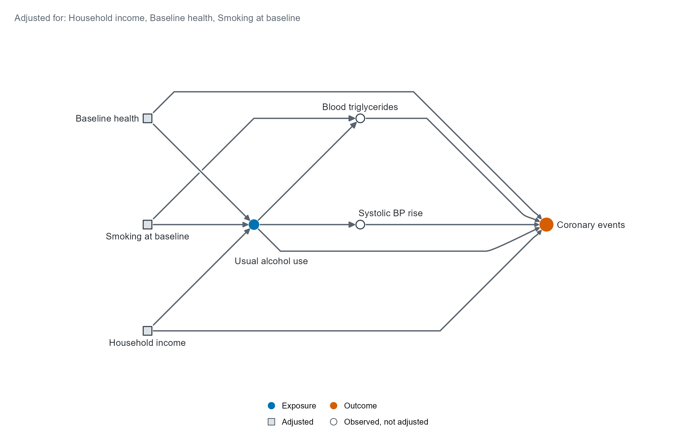
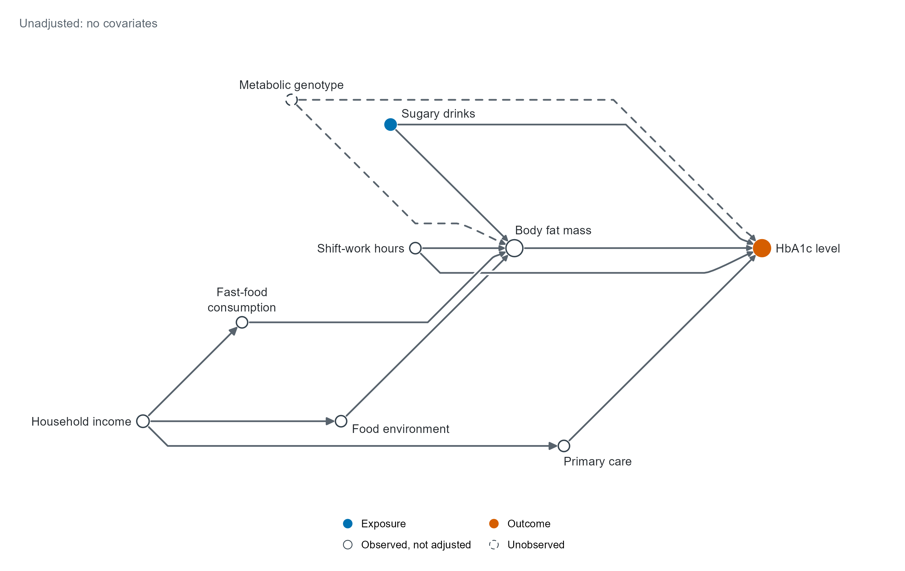

# Bringing the branches closer together

Rank-gap compaction alone left excess space in DAGs 1 and 3. This refinement
moves branches together and reroutes their arrows. The baseline is merged PR #32,
commit `c48ae8b16f1f5d4379e20b028bd87117b87d79b1`. Both versions use the same
edges, labels and annotations, automatic placement, and 240 mm export width.
No manual coordinates, routes or label nudges are supplied.

| Measure | DAG 1 before | DAG 1 after | DAG 3 before | DAG 3 after |
|:--|--:|--:|--:|--:|
| Transverse span, grid units | 11 | 10 | 26 | 19 |
| Span along the causal direction | 19 | 18 | 31 | 26 |
| Layout area, square grid units | 209 | 180 | 806 | 494 |
| Bends | 15 | 13 | 13 | 11 |
| Crossings | 4 | 3 | 8 | 8 |
| Total line length | 123.57 | 115.08 | 251.87 | 202.58 |
| Unrelated station collisions | 0 | 0 | 0 | 0 |

Area includes all node centres and routed segments, before plot padding and
labels. It falls by 14% in DAG 1 and 39% in DAG 3. These percentages describe
layout coordinates, not exported image area: a fixed export width changes the
physical scale as the drawing becomes more compact. Equal coordinate scaling
retains the 45-degree diagonals.

## DAG 1 — alcohol and heart disease

| Before | After |
|:--|:--|
| _DAG 1 before: figure not retained_ |  |

Usual alcohol use, Systolic BP rise and Coronary events now align. The long
income arrow keeps three bends, while the complete drawing loses two bends and
one crossing.

## DAG 3 — sugary drinks and HbA1c

| Before | After |
|:--|:--|
| _DAG 3 before: figure not retained_ |  |

The fan around Body fat mass becomes narrower. Its straight arrows from
Sugary drinks and Food environment stay straight, and the link to HbA1c level becomes
straight too. The five previously straight arrows remain straight.

## Algorithm and limits

Connected straight arrows constrain relative node offsets when a gap shrinks.
The search places those groups closer together using scaled and grid-aligned
targets, preserving ranks, ties and the existing order within each rank.
Four-unit node spacing and feasible monotone edge spans are checked before
routing. Up to eight feasible placements are tried per component, each with
short-first and long-first routing orders. A work budget further limits the
number of placements to floor(24,000 / (route steps × arrows)); components above
that budget skip this stage. Resized versions of the previous
route shapes supplement the existing simple-route candidates.

A placement is accepted only if the complete routed drawing has a smaller
transverse extent without increasing its causal extent, crossings, pairwise
shared-track length, bends or total line length. Already straight arrows stay
straight. Rerouting initially retains existing station clearance up to two
units; final straightening uses the existing 0.8-unit routing floor. Old
whitespace can shrink. After accepting a placement, the existing bounded gap
compactor and approach refinement run again to use newly available slack.

This is a bounded heuristic, not a global area optimum or a label-aware layout.
Three-unit final approaches are a preference, not an invariant. The renderer
still determines physical arrowhead and label clearance at export time.
DAG 4 retains its three-unit middle approach into Vascular events.

The six README examples have all been regenerated. DAGs 1, 3 and 4 pass SVG and
PNG diagnostics at 180 and 240 mm, with PNG at 180 dpi. Every gallery SVG retains
one arrowhead per causal edge. DAG 2 has a PM2.5 exposure label/route warning on
both devices (previously a Airway swelling warning on SVG only); DAG 5 retains
its Obesity class warning on both devices. These remain visible in the gallery
and in [the diagnostic table](annotated_gallery_diagnostics.csv).

The [22-fixture benchmark](arrangement_metrics.csv) compares canonical, random,
disconnected and annotated graphs, including explicit ranks. It checks geometric
quality and extents against the baseline: all 22 preserve or improve the checked
measures, eight use less area and five have fewer bends. The causal README
example also becomes smaller while retaining four bends, zero crossings and
its straight outer arrows. Timings are single-run smoke
measurements on a shared machine; the extra searches can increase runtime.
See [reproduction commands](README.md).
