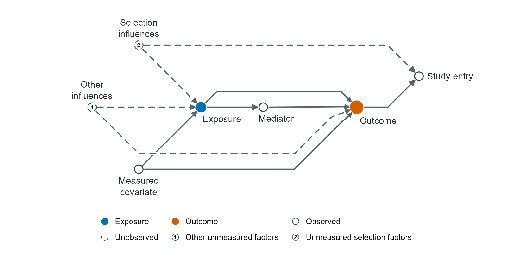
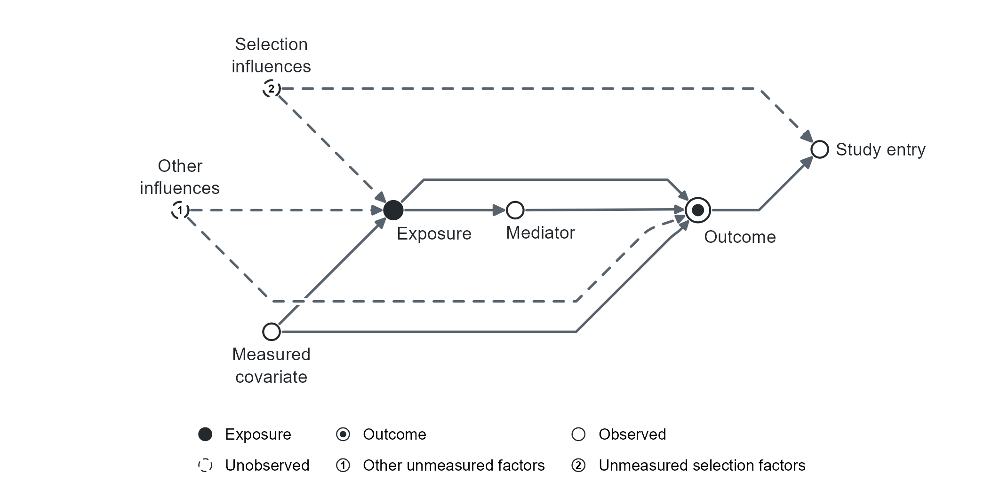
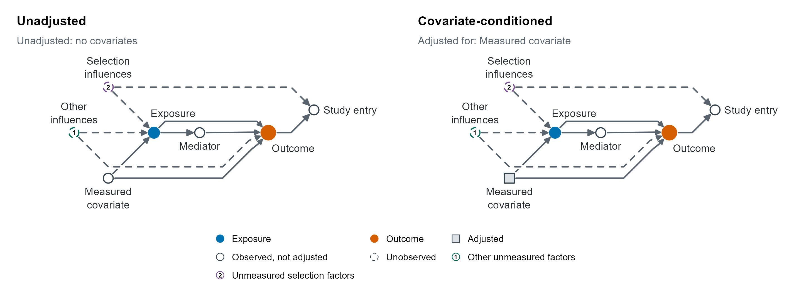

# Custom display groups

Baseline: main at `0ee057a8976d4d25f3ae26196f47904acad0e6b2`, including the merged layout fixes in PRs #41–43. This feature changes annotations and rendering; layout and routing algorithms are unchanged.

`node_groups` is a named list of non-empty character vectors of existing node identifiers. Each node may belong to one display group, alongside its existing analysis role and observability. Group names are arbitrary labels: “Selected”, “Unobserved” or “Adjusted” do not activate those statuses. Actual DAGitty selection nodes remain rejected, and adjustment checks continue to use the existing explicit annotations.

Small numbered marks inside stations identify groups without increasing station footprints. Numbers follow group names in UTF-8 byte order, independent of list/member/graph ordering. Exposure/outcome fills, adjustment squares and unobserved station/route dashes remain intact. Optional `node_group_colours` alter outlines only and are ignored in monochrome. Numeric marks use contrasting black/white ink and fit inside the station, including multidigit marks. Mark text follows the requested font family.

NULL inherits groups from a reused layout. A supplied list replaces all groups; `list()` clears them. NULL colour overrides inherit matching group names; a supplied vector replaces overrides and `character(0)` clears them. Categories are stored as `layout$node_groups`, separately from `layout$analysis`; colours use `layout$node_group_colours`. The plot also exposes `metrodag_node_groups`. Stored coordinates, routes and variable label text are unchanged.

Comparisons accept groups/colours as shared outer arguments, not per-view analysis arguments. Every panel retains the same numbering and one combined legend. Custom legend labels reflow from their original text on each output device. The reflow clones mutable scales so exporting a narrow figure cannot change a reusable plot's labels.

## Rendered examples

The [generator](../examples/node_groups.R) illustrates an unmeasured determinant of study entry separately from another unmeasured common cause. The ordinary study-entry node does not assert conditioning on selection. Both analysis views retain the unmeasured causes; the covariate-conditioned view is not a claim of causal identification.

| Publication | Monochrome |
| --- | --- |
| [](figures/node_groups.svg) | [](figures/node_groups_monochrome.svg) |

[](figures/node_groups_comparison.svg)

All three PNGs and rasterized SVGs were inspected. The [ten format/width checks](node_groups_render_checks.csv) pass without errors or warnings: publication and monochrome at 120/180 mm, comparisons at 240 mm. SVGs retain all ten arrows per panel and twenty in the comparison.

## Compatibility and validation

The six existing annotated gallery definitions are unchanged. Fresh main and feature checkouts were rendered in the same runtime: all six PNG/SVG pairs and the metric, diagnostic and render-check CSVs are byte-identical. [Fifteen comparisons](node_groups_gallery_compatibility.csv) record the result. Node identities, graph attributes, labels, analysis metadata, stored geometry and layout parameters were also compared and preserved. Existing committed gallery assets are retained; DAGs 2 and 4's committed renders differ slightly from a fresh main render in this runtime, independently of this feature.

The focused tests cover inheritance/replacement/clearing, validation and last-plot state, retained analysis symbols/observability, arbitrary category names, reordered inputs and four directions, all drawing styles, PDF/PNG/SVG export, arrow/mark counts, shared comparison legends, font inheritance and device reflow without mutation.

Validation on R 4.3.3 with ggplot2 3.4.4:

| Check | Result |
| --- | --- |
| Full test coverage, all 53 files / 272 test blocks | 7,652 passing assertions; five optional DAGitty skips; no failures, errors or warnings |
| Final focused rerun, three files / 17 test blocks | 244 passing assertions, including 145 for the nine new group tests |
| Package build and `R CMD check --no-tests --no-manual` | No errors or warnings; one NOTE for unavailable optional DAGitty |
| New example diagnostics | Ten format/width checks pass, with all arrows retained |
| Existing gallery compatibility | All fifteen file comparisons pass |

The long test run was resumed from per-file checkpoints after an execution interruption. The totals cover every test file once, using the final three-file rerun for the legend-font refinement. The final source package was built from the staged Git tree, excluding temporary test outputs. `.Rbuildignore` also excludes interrupted-render temporary files.

At feature commit `f182a0a`, [CI run 41134817183](https://github.com/hdbt/metrodag/actions/runs/41134817183) failed before executing package code: all four jobs have runner ID 0, no runner name and no steps. The cause is unknown. Local validation does not establish compatibility with the other R, ggplot2 and operating-system versions in that matrix.

Each node has one display category; overlapping memberships are rejected. Category marks add visual detail and legend entries. Multi-digit marks shrink within the existing station footprint, so adding categories can enlarge the legend without changing stored layout metrics. Outline colours are optional; numbered marks carry the category distinction in monochrome.

Reproduce from the package root:

```sh
R CMD INSTALL .
Rscript data-raw/node_groups.R
Rscript -e 'testthat::test_local()'
R CMD build .
_R_CHECK_FORCE_SUGGESTS_=false R CMD check --no-tests --no-manual metrodag_0.2.0.9000.tar.gz
```
