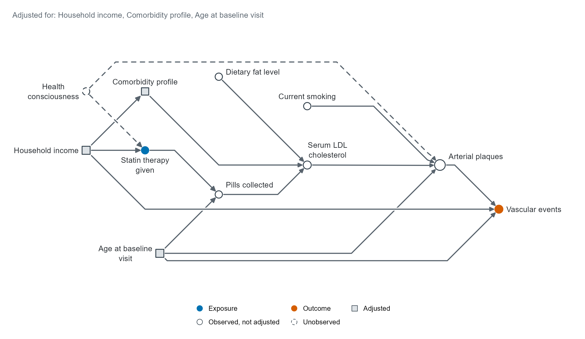

# Bringing distant variables closer to their connections

DAG 4 still had excess space after node arrangement compaction. Smoking
exposure sat in the first column even though its only arrow led to Arterial
plaques much farther along the chain. Keeping those columns fixed limited
what local compaction could accomplish.

The new automatic-rank search moves Current smoking to the column immediately
before Arterial plaques and rebuilds the drawing. These figures compare merged
PR #33, commit `df9f782df7010b954932f1d6438efaf6a186e270`, with the new algorithm.
Both use the same edges, labels, annotations and renderer at 240 mm width.
No manual ranks, positions, route edits or label nudges are supplied.

| Measure | Before | After |
|:--|--:|--:|
| Transverse span, grid units | 27 | 17 |
| Span along the causal direction | 35 | 35 |
| Routed area, square grid units | 945 | 595 |
| Bends | 17 | 16 |
| Crossings | 5 | 5 |
| Pairwise shared-track length | 1 | 1 |
| Total line length | 291.52 | 264.10 |
| Unrelated station collisions | 0 | 0 |

The routed area falls by **37%**. Area includes node centres and routed
segments, before labels and plot padding. This is a coordinate-space measure;
a fixed export width changes the physical scale as the drawing becomes more
compact. Equal coordinate scaling preserves the 45-degree diagonals.

| Before | After |
|:--|:--|
| _DAG 4 before: figure not retained_ |  |

## Algorithm and limits

After the existing placement and routing refinements, find legal single-node
rank moves that reduce total incident rank span. A node may move towards its
children or parents while remaining after every parent and before every child.
Try the largest span reductions first, breaking ties by lower degree and node
name. Rebuild with the trial ranks fixed, so fan placement cannot undo the
proposed rank assignment and the rank search cannot recurse.

Try at most three rebuilds per component, further limited to
floor(12,000 / (route steps × arrows)). Large components can skip this search.
Accept the first smaller routed area with neither extent growing, and no
increase in crossings, pairwise shared-track length, total bends or line length.
Require four-unit station spacing and at least 0.8 units between routes and
unrelated stations. Explicit ranks bypass this search and retain their ordering
and ties, including the wave alignment in DAG 6.

Individual routes, within-rank orders and metro path colours can change when
a component is rebuilt. The earlier local refinements preserve straight arrows
within their own searches; this final search compares the total bend count.
It retains the original causal example's straight socioeconomic-background and
occupational-hazards arrows. The existing final-approach refinement runs in each
rebuild; three-unit approaches remain a preference rather than an invariant.

This bounded heuristic does not guarantee minimum area. It also costs additional
layout time when candidates are considered, including unsuccessful searches.
In this single run, DAG 4 took 6.0 seconds versus 2.3, and DAG 3 took 9.0 versus
2.7 despite retaining its previous layout. The work budget skips the large
random components. These timings are smoke measurements on a shared machine,
not a controlled performance study.

## Evaluation

The [22-fixture benchmark](rank_refinement_metrics.csv) checks canonical,
random, disconnected and annotated graphs against the merged baseline. Every
fixture preserves or improves the checked extents, crossings, shared tracks,
bends, line length and station collisions. Only DAG 4 changes geometry in this
set; the other five README gallery layouts remain unchanged. The explicitly
ranked drawing retains identical nodes and routes.

All six README examples have been regenerated. DAG 4 has no SVG or PNG
diagnostic issues at 180 or 240 mm, with PNG at 180 dpi. All 78 gallery SVG
arrowheads are present, one per original edge. The existing PM2.5 exposure
warning in DAG 2 and Obesity class warning in DAG 5 remain in both SVG and PNG;
see the [gallery diagnostics](annotated_gallery_diagnostics.csv).

Regression tests cover automatic movement, explicit rank ties, source- and
sink-aligned candidates, causal edge identity, route continuity and clearance,
input-order stability, rotations, component packing and search limits. Older
stage-specific tests isolate their refinements from the new final search.
See the [reproduction commands](README.md).
