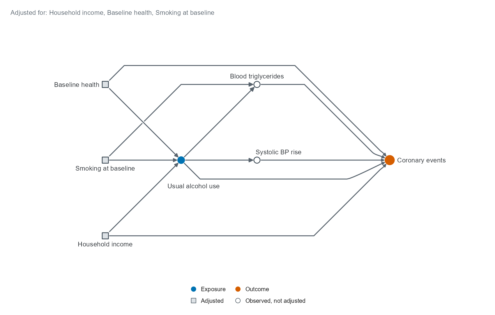
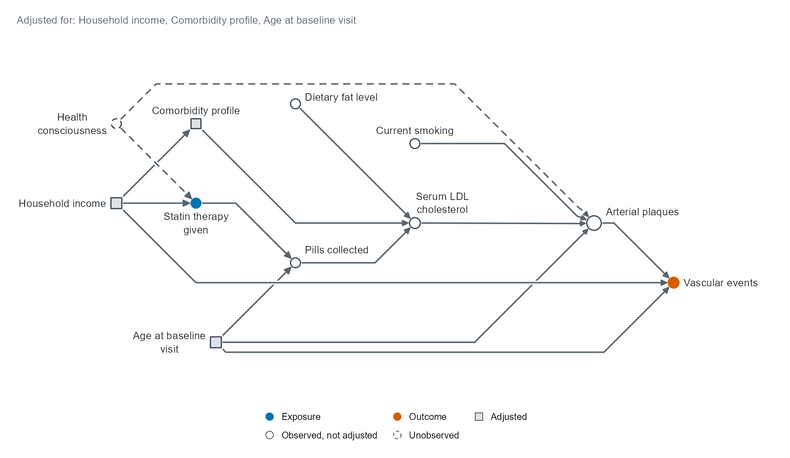

# Simplifying sections of long arrows

The review examples exposed staircases that whole-arrow candidates could not
remove. A useful simpler route can still need three or more bends to retain
clear entrances to crowded stations. The final cleanup now replaces sections
between existing bends, neighbouring grid points and short endpoint stubs.

Baseline: main commit `32884467e422aeb643d7b0f390118249d417c115` (merged PR #30).
Both sides use automatic routing and the same graph, labels and annotations.
The causal structures and adjustment annotations are illustrative.

| Arrow | Before | After |
|:--|--:|--:|
| DAG 1: Household income → Coronary events | 6 bends | 3 bends |
| DAG 4: Health consciousness → Arterial plaques | 8 bends | 3 bends |

| Complete drawing | Bends before → after | Crossings before → after | Shared length before → after | Line length before → after |
|:--|:--|:--|:--|:--|
| DAG 1 | 18 → 15 | 4 → 4 | 2.83 → 2.41 | 158.23 → 156.57 |
| DAG 4 | 25 → 18 | 5 → 5 | 1.41 → 1.00 | 328.84 → 327.18 |

Node positions and causal directions are unchanged. Both diagrams retain zero
unrelated node–edge collisions. Shared length counts every pair of arrows on a
track, not only the union of occupied segments. Lengths are in layout grid units.

## DAG 1 — alcohol and heart disease

| Before | After |
|:--|:--|
| _Alcohol and heart disease before: figure not retained_ |  |

## DAG 4 — statin events

| Before | After |
|:--|:--|
| _Statin events before: figure not retained_ |  |

The PNG and editable SVG review figures use 240 mm width, default label wrapping
and automatic label placement, with no manual route or label nudges. Both before
and after drawings pass PDF, SVG and PNG device diagnostics at that width. At
180 mm, the updated DAG 4 has a label-route warning for Comorbidity profile;
routing does not optimize label boxes. The larger review export resolves it.

## Safeguards and limits

- Keep station positions, edge endpoints, edge/path identities and explicit ranks.
- Strictly reduce bends without increasing crossings, pairwise shared-track
  length or total line length; recheck the completed cleanup with the public
  crossing definition.
- Preserve existing station clearance up to four grid units, with a floor of
  0.8. This avoids reducing a generous gap to a one-unit near miss that can
  collide with the visible station on export.
- Make at most 24 route attempts per component over two passes, considering
  24 sections and checking at most 128 shortlisted alternatives per attempt.
  Candidate generation scales with section length. The search is deterministic
  and does not guarantee a global minimum number of bends.

Component packing runs after cleanup and can translate a component when its
routed extent shrinks. Relative station positions within that component remain
fixed. Figure size, fonts, labels and high-degree attachments still need checking
on the intended output device.

See [route_cleanup_metrics.csv](route_cleanup_metrics.csv) for before/after
results on 22 fixtures through 100 nodes, and the [reproduction commands](README.md).
All 22 preserve or improve crossings, shared length, bends, line length and
station collisions. Four have fewer bends; one crowded 12-node fixture also
loses a crossing. The four-bend causal README example is unchanged.

One-run layout time was 1.30 → 1.62 seconds for DAG 1, 0.92 → 1.22 seconds for
DAG 4, and 29.09 → 35.25 seconds for the sparse 100-node fixture. The extra search
adds work even when it finds no acceptable improvement.
The benchmark excludes rendering and diagnostics from layout timings. These are
single-run smoke measurements on one machine, not a performance study.
