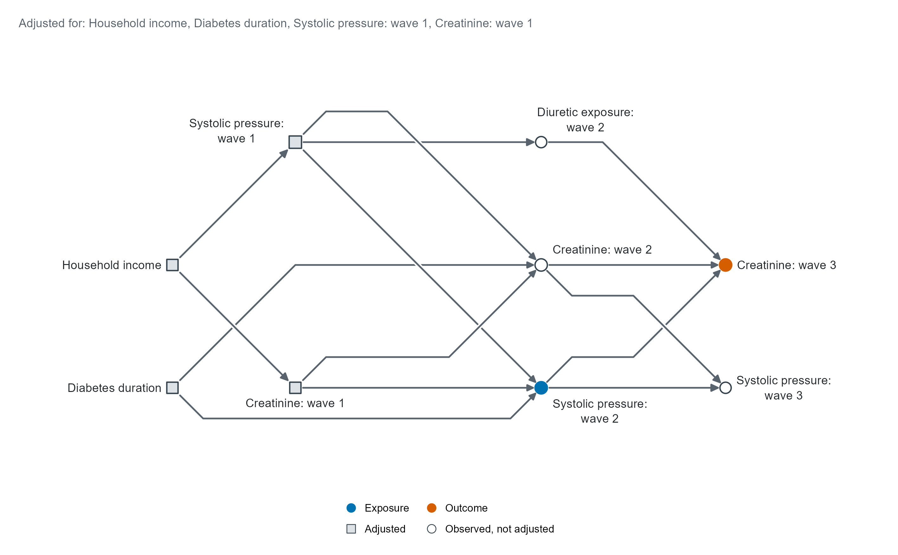
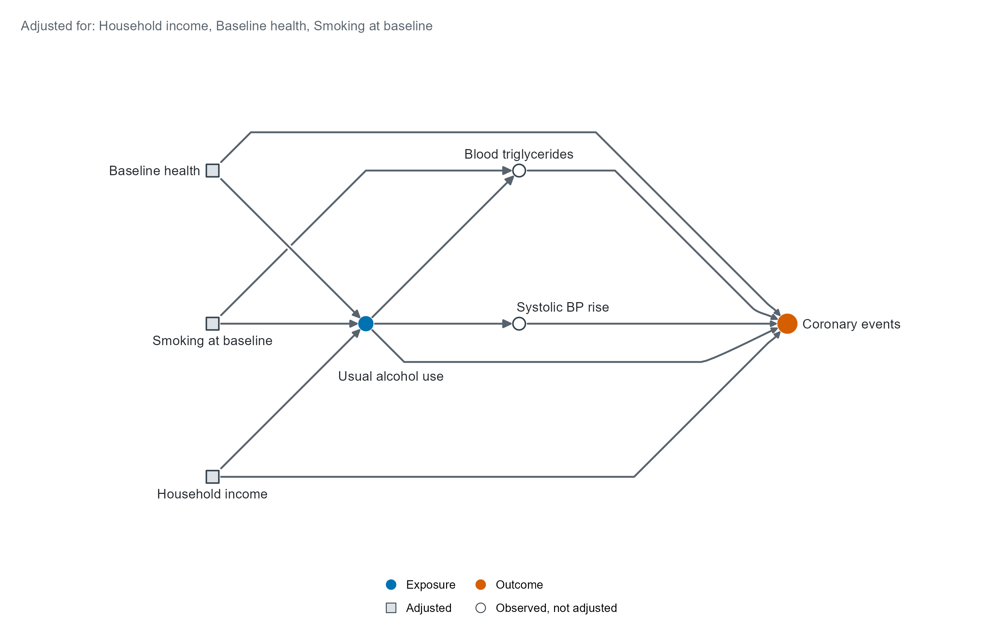
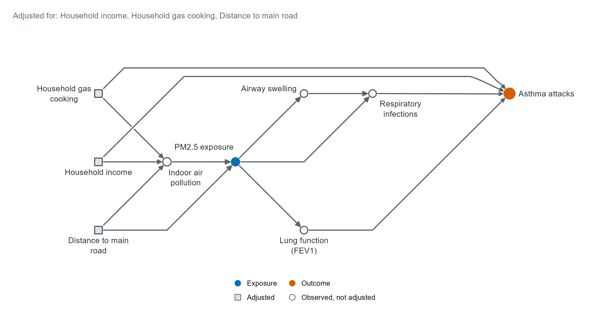
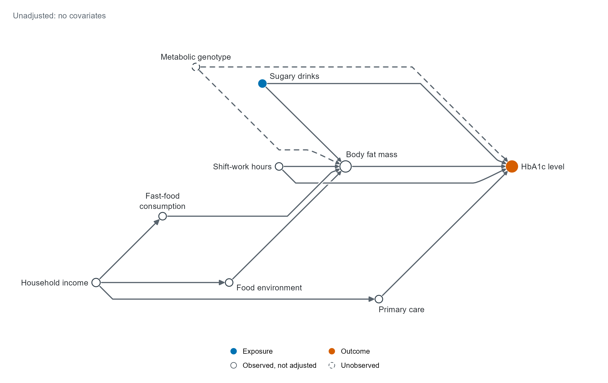
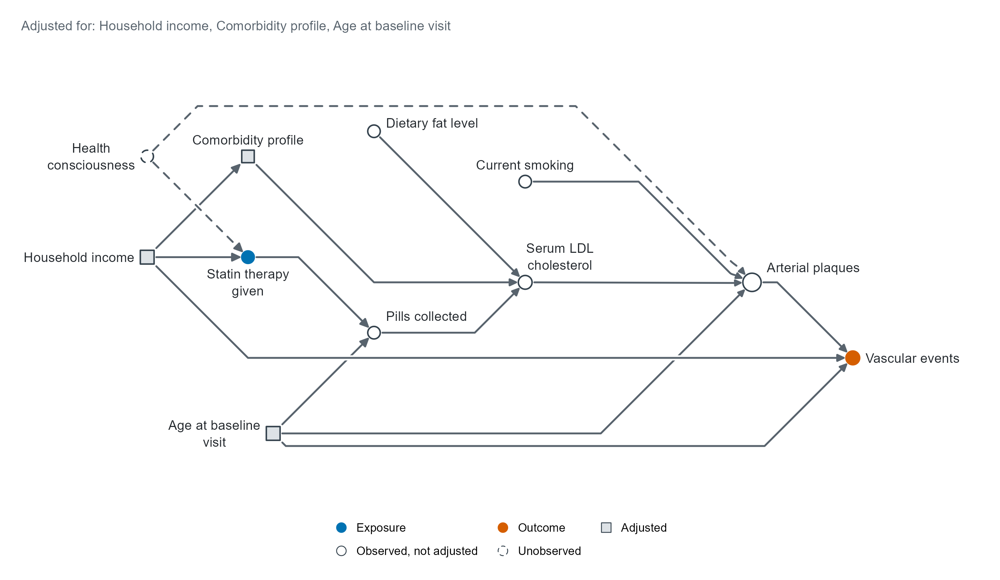
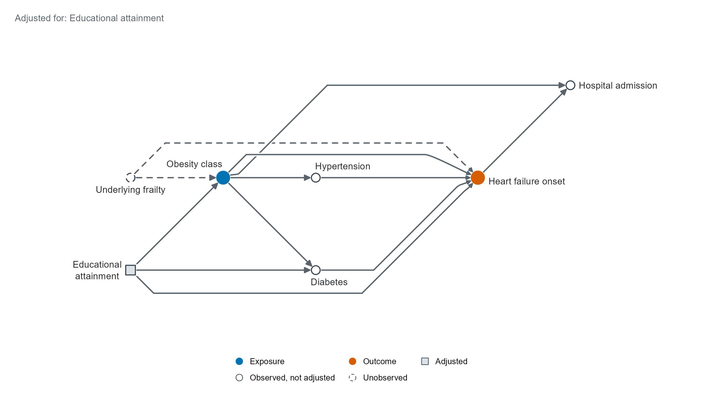
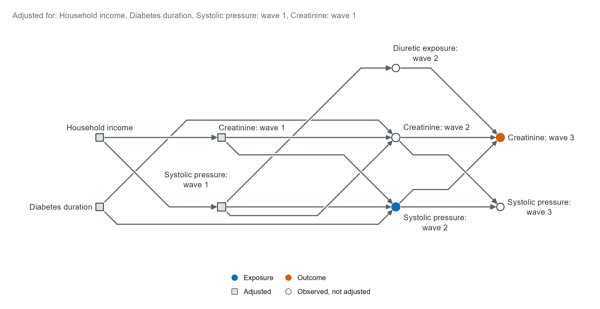

# Visual review of the six annotated DAGs

Baseline: main at `0ecfa6093131f9cf8ecd03397754c4d6289c8ae6`, after PRs #37–40 merged. Earlier wrapping, label-collision, rank/initializer, source-placement, half-grid routing and geometric station-port fixes are preserved. [Previous iteration and evidence](https://github.com/hdbt/metrodag/blob/0ecfa6093131f9cf8ecd03397754c4d6289c8ae6/inst/benchmarks/VISUAL_REFINEMENT.md).

Every causal node, edge, identifier, direction, display label, analysis role and supplied layout constraint is preserved. DAGs 1–5 retain automatic ranks; DAG 6 retains its wave ranks and two explicit alignment groups. Only DAG 3's Primary care changes coordinates and only its two incident routes change geometry. Automatic layer/order/gap metadata is rebuilt, including HbA1c level's layer and Occupational hazards's order. No example-specific coordinates, routes or label nudges were added. Names do not imply repeated-variable identities or adjustment recommendations.

## Measured comparison

Before → after, using stored geometry before physical station attachments, label placement and margins. Shared length counts each overlapping arrow pair; shared pairs count overlapping merged straight runs.

| DAG | Crossings | Bends | Route length | Area | Shared pairs | Shared length |
| --- | ---: | ---: | ---: | ---: | ---: | ---: |
| 1: Alcohol and heart disease | 3 → 3 | 10 → 10 | 100.25 → 100.25 | 153 → 153 | 2 → 2 | 1.91 → 1.91 |
| 2: PM2.5 exposure | 2 → 2 | 7 → 7 | 130.64 → 130.64 | 228 → 228 | 1 → 1 | 1.41 → 1.41 |
| 3: Sugary drinks and HbA1c | 6 → 6 | 10 → 10 | 152.95 → 150.47 | 425 → 350 | 4 → 4 | 3.83 → 3.83 |
| 4: Statin events | 4 → 4 | 13 → 13 | 190.02 → 190.02 | 418.5 → 418.5 | 1 → 1 | 0.50 → 0.50 |
| 5: Obesity and admission | 5 → 5 | 10 → 10 | 110.84 → 110.84 | 171 → 171 | 3 → 3 | 2.41 → 2.41 |
| 6: Longitudinal, aligned | 8 → 8 | 15 → 15 | 144.98 → 144.98 | 207 → 207 | 0 → 0 | 0.00 → 0.00 |

DAG 3 uses **17.6% less routed area and 1.6% less line length**, with unchanged crossings, bends and shared length. This is a branch-placement improvement, not a crossing reduction. The other five drawings retain their geometry. All six have zero station/edge collisions and forward consistency one.

[Full comparison](annotated_gallery_comparison.csv), [metrics](annotated_gallery_metrics.csv), [240 mm diagnostics](annotated_gallery_diagnostics.csv), [180/240 mm rendering checks and SVG arrow counts](annotated_gallery_render_checks.csv).

## Algorithm and trade-offs

Earlier searches preserve every straight arrow, which can lock an intermediate near its parent even when placing it closer to its child would improve the branch. A new late pass considers nodes with parents and children and at most three incident arrows. It protects endpoints of collinear straight through-chains; when none exists, it protects the straight arrow with the greatest causal span. A formerly straight side arrow may acquire a bend while its neighbour straightens. This uses geometry and connectivity, not roles, label text or repeated-variable names.

Try transverse positions towards the neighbours' median and parent/child positions, with feasible causal positions between parents and children. Retain strictly forward edges, four-unit station spacing and 0.8-unit unrelated-station clearance. Reroute incident and newly obstructed arrows together, simplify eligible arrows and refine final approaches. Evaluate at most 24 placements, further limited to `floor(60000 / (route steps * arrows))`, and accept one best move. Larger components may skip the pass. Explicit ranks/alignment, disabled ordering and zero sweeps skip it. It runs after alternative starts/source placement and before packing, half-grid routing and rotation.

Judge final half-grid geometry by expanding mixed step sizes onto a doubled integer grid. This prevents a coarse-grid improvement from undoing the previous routing gains. Neither crossings, pairwise shared length, line length, either extent nor any arrow's transverse reversals may increase. Area must shrink. One extra bend requires at least 15% less area; two require at least 25%. Within these guards, crossings then shared length take priority, followed by `area ratio + 0.5 * length ratio + 0.1 * extra bends`, relative to the pass's input. Apply the same bounds before half-grid refinement, since packing components can exceed that later pass's work budget. This bounded search does not guarantee a global optimum.

**Supplied constraint changes: none.** Automatic intermediate positions, ranks and within-rank orders may change. In DAG 3, Household income → Primary care gains a bend and Primary care → HbA1c level becomes straight; the total stays ten bends. Their respective route lengths change 5.66 → 17.41 and 25.56 → 11.31 units. The incoming leg becomes longer, while combined ink decreases. Shift-work hours → Tar deposits → HbA1c level remains fixed and straight.

The [22-fixture comparison](visual_refinement_metrics.csv) changes only DAG 3; the other 21 fixtures retain all seven recorded geometry metrics. The paired final run took 223.646 seconds before and 243.030 after (8.7% more overall); DAG 3 took 35.654 → 35.791 seconds. Other R checks shared the machine, so these are noisy single-run timings, not a stable speed estimate. Rejected candidates still cost routing time.

## Rendered review and remaining issues

Actual baseline and final PNGs and rasterized SVGs were inspected, including both publication widths. All 24 PNG/SVG diagnostics at 180/240 mm are clear, and each SVG set retains all 78 causal arrowheads. Raster arrowheads were inspected visually; the table does not invent a PNG primitive count. Device font metrics can select different clear label positions.

| DAG | Inspection of the actual PNG and SVG |
| --- | --- |
| 1 | Unchanged. Usual alcohol use stays close and clear and the earlier Coronary events fan fix is retained. Household income and Baseline health still form an open outer frame; income's small initial staircase and mediator spacing remain. |
| 2 | Unchanged. Indoor air pollution → PM2.5 exposure keeps the V removed and the label clear. Long lower bypasses and Asthma attacks's tight four-arrow fan/shared terminal diagonal remain. |
| 3 | Primary care moves downstream and inward, removing the low/left outlier and making its arrow into HbA1c level straight. The Household income branch is visibly tighter while the main straight chain stays fixed. Food environment and Primary care use visibly separated parallel departures. Four short shared pairs, six crossings and crowded approaches remain; the upper dashed Metabolic genotype bypass is still long. |
| 4 | Unchanged. The four-crossing/13-bend geometry and tighter lower bypass are retained. The dashed Health consciousness detour is long, whitespace remains, and the car/rides/access chain changes level. At 180 mm the car-access label moves farther below/left of its station: clear, but less closely associated. |
| 5 | Unchanged. Obesity class stays clear and its source transition avoids backtracking. Heart failure onset remains prominent before Hospital admission. Short converging attachments, late branches, three shared pairs and the upper dashed detour remain. |
| 6 | Unchanged. Repeated chains stay straight, supplied wave ranks stay fixed, and labels retain wave-number groups. Cross-lagged arrows retain eight crossings. Alignment's crossing cost remains substantial. |

## Alignment trade-off

The gallery continues to demonstrate explicit alignment. The separate comparison omits only `align`, preserving graph, labels, roles and wave ranks. [Generator](alignment_comparison.R), [metrics](alignment_comparison_metrics.csv).

| Wave layout | Crossings | Bends | Route length | Area | Shared length |
| --- | ---: | ---: | ---: | ---: | ---: |
| Rank only | 5 | 14 | 128.23 | 200 | 0 |
| Rank plus explicit alignment | 8 | 15 | 144.98 | 207 | 0 |

Alignment still costs three crossings, one bend, 13.1% more line length and 3.5% more area. The new placement stage skips both versions because ranks are supplied. Consistent repeated rows can aid longitudinal reading; rank-only remains preferable here when minimizing crossings takes precedence. Both retain wave ordering, every arrow and warning-free labels. The vignette's stale aligned-area value is corrected to 207.

[](figures/annotated_06_longitudinal_rank_only.svg)

## Before and after images

Left: exact merged-main baseline. Right: refreshed PNG linking to SVG. Both use 240 mm width.

| DAG | Before | After |
| --- | --- | --- |
| 1 | [](https://github.com/hdbt/metrodag/blob/0ecfa6093131f9cf8ecd03397754c4d6289c8ae6/inst/benchmarks/figures/annotated_01_alcohol_heart.svg) | [](figures/annotated_01_alcohol_heart.svg) |
| 2 | [](https://github.com/hdbt/metrodag/blob/0ecfa6093131f9cf8ecd03397754c4d6289c8ae6/inst/benchmarks/figures/annotated_02_air_pollution.svg) | [](figures/annotated_02_air_pollution.svg) |
| 3 | [](https://github.com/hdbt/metrodag/blob/0ecfa6093131f9cf8ecd03397754c4d6289c8ae6/inst/benchmarks/figures/annotated_03_sugary_drinks.svg) | [](figures/annotated_03_sugary_drinks.svg) |
| 4 | [](https://github.com/hdbt/metrodag/blob/0ecfa6093131f9cf8ecd03397754c4d6289c8ae6/inst/benchmarks/figures/annotated_04_statin_events.svg) | [](figures/annotated_04_statin_events.svg) |
| 5 | [](https://github.com/hdbt/metrodag/blob/0ecfa6093131f9cf8ecd03397754c4d6289c8ae6/inst/benchmarks/figures/annotated_05_obesity_admission.svg) | [](figures/annotated_05_obesity_admission.svg) |
| 6 | [](https://github.com/hdbt/metrodag/blob/0ecfa6093131f9cf8ecd03397754c4d6289c8ae6/inst/benchmarks/figures/annotated_06_longitudinal.svg) | [](figures/annotated_06_longitudinal.svg) |

## Reproduction and validation

```sh
R CMD INSTALL .
Rscript data-raw/annotated_gallery.R
Rscript inst/benchmarks/alignment_comparison.R
Rscript inst/benchmarks/visual_refinement_benchmark.R /path/to/0ecfa6-checkout
Rscript -e 'testthat::test_local()'
R CMD build .
_R_CHECK_FORCE_SUGGESTS_=false R CMD check --no-tests --no-manual metrodag_0.2.0.9000.tar.gz
```

The new regression file passes **192 assertions across five tests**, covering frozen converging-parent geometry, straight chains, bend exchange, endpoint/edge identity and clearance, renamed/reordered inputs, work limits, bounded trade-offs, explicit constraints, automatic metadata and all four public directions. The earlier six-file targeted run also passed. Stage-specific older fixtures bypass the new placement only where necessary to preserve their isolated assertions.

Normal installation, vignette rendering, all 13 Rd checks, package build and `git diff --check` pass. `R CMD check --no-tests --no-manual` reports **zero errors/warnings and one NOTE** for unavailable optional DAGitty. All six gallery definitions, graph/vertex/edge attributes, labels, roles, path identities and supplied rank/alignment constraints were compared against baseline and preserved.

**Full suite: 7,374 passing assertions across 220 tests in all 51 files**, with 5 optional DAGitty skips and zero failures, errors or warnings. The run completed 34 files before the workspace interruption; all 17 remaining files were then run as a completion batch. The implementation and regression files are unchanged, and the combined results verify that every test file was covered exactly once. The PR is ready for review.

Main's [CI run 40585509619](https://github.com/hdbt/metrodag/actions/runs/40585509619) failed before steps: all four jobs had `runner_id = 0` and `steps = []`. Available metadata does not identify the startup cause. Local validation does not establish cross-platform CI success; the PR records its own current CI status separately.
